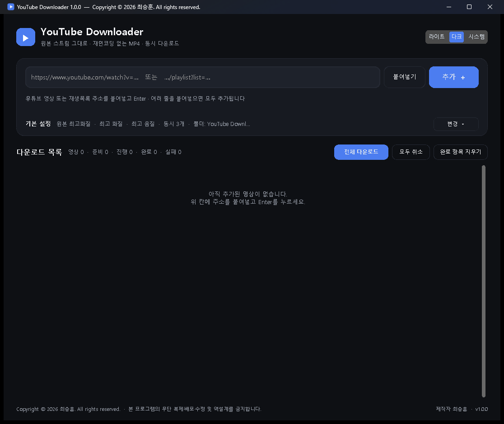

# YouTube Downloader



유튜브 영상을 **원본 스트림 그대로(재인코딩 없이) MP4**로 여러 개 동시에 받는 Windows 프로그램입니다.

**[⬇ 다운로드](../../releases/latest)** · **[📖 사용설명서 (Wiki)](../../wiki)** · **[🛠 문제 해결](../../wiki/4-문제-해결)**

## 특징

- **재인코딩 없음** — 스트림을 복사해 MP4로 합치므로 화질 손실이 없습니다
- **동시 다운로드** — 최대 8개까지 한 번에 받습니다
- **재생목록·채널** — 주소 하나로 묶어서 추가하고, 화질을 일괄로 바꿀 수 있습니다
- **영상마다 따로 설정** — 화질, 해상도, 음질, 저장 폴더를 카드에서 고릅니다
- 여러 줄 붙여넣기, 라이트 / 다크 / 시스템 테마

## 빠른 시작

Windows 10 / 11 (64비트)에서 동작합니다. Python은 따로 설치하지 않아도 됩니다.

1. [Releases](../../releases/latest)에서 `YouTubeDownloader_Setup_1.0.0.exe` 를 받아 설치합니다.
2. 프로그램을 실행하고 영상 주소를 붙여넣은 뒤 **Enter** 를 누릅니다.
3. 화질을 고르고 **[다운로드]** 를 누릅니다.

> 처음 실행할 때 'Windows의 PC 보호' 창이 뜨면 **[추가 정보] → [실행]** 을 누르세요.
> 코드 서명이 없는 개인 제작 프로그램이라서 나오는 경고입니다.

자세한 사용법은 **[사용설명서 (Wiki)](../../wiki)** 를 보세요.

## 주의

저작권자의 허락을 받았거나 정당한 이용 권한이 있는 영상에만 사용하세요.
영상의 다운로드·이용에 따른 책임과 [YouTube 서비스 약관](https://www.youtube.com/t/terms) 준수 책임은 사용자에게 있습니다.
로그인이 필요한 영상이나 DRM이 적용된 영상은 받을 수 없습니다.

"YouTube"는 Google LLC의 상표이며, 이 프로그램은 YouTube 또는 Google과 관련이 없습니다.

## 라이선스

```
Copyright (c) 2026 최승훈. All rights reserved.
https://gwchoi.com · gwchoi96@gmail.com
```

**소스 코드를 공개하지만 오픈소스는 아닙니다.** 자세한 조건은 [LICENSE](LICENSE)를 참고하세요.

| 허용 | 금지 (사전 서면 허락 필요) |
|---|---|
| 프로그램·소스 코드 내려받기 | 소스 코드·실행 파일 수정, 2차적 저작물 제작 |
| 프로그램 사용 | 원본·수정본 재배포, 판매, 대여 |
| 소스 코드 열람, 수정 없이 본인 PC에서 빌드·실행 | 실행 파일 역설계 |
| 공식 저장소 링크 공유 | 저작자 표시·라이선스 문구 삭제 |

함께 배포하는 FFmpeg, Node.js, yt-dlp 등은 각자의 라이선스를 따릅니다.
[제3자 구성 요소 고지](installer/THIRD_PARTY_NOTICES.txt)를 참고하세요.

<details>
<summary><b>개발자용: 폴더 구성·빌드 방법</b></summary>

위 라이선스에 따라 수정본의 배포는 허용되지 않습니다. 아래 내용은 원본을 직접 빌드해 확인하거나 저작자가 유지보수할 때 씁니다.

### 폴더 구성

| 경로 | 내용 |
|---|---|
| `src\youtube_downloader.py` | 프로그램 원본 코드 |
| `assets\` | 프로그램 아이콘 |
| `bin\` | FFmpeg·Node.js 자리. 저장소에는 라이선스 원문만 있습니다 |
| `installer\setup.iss` | 설치 프로그램 설정 (Inno Setup) |
| `installer\EULA_ko.txt` | 설치할 때 동의하는 사용권 계약서 |
| `installer\THIRD_PARTY_NOTICES.txt` | 제3자 구성 요소 고지 |
| `installer\licenses\` | 설치 파일에 함께 넣는 라이선스 원문 |
| `tools\build.ps1` | 빌드 스크립트 (컴파일 → 설치 파일) |
| `tools\setup_build_env.ps1` | 빌드 환경 준비 (최초 1회) |
| `tools\make_icon.py` | 아이콘 다시 만들기 |
| `tools\test\` | 빌드본 시험 도구 |
| `유튜브다운로더_실행.bat` | 개발용 실행 (원본 코드 그대로 실행) |

사용자 설정은 `%APPDATA%\YouTube Downloader\settings.json` 에 저장됩니다.
기본 저장 폴더는 `내 PC\다운로드\YouTube Downloader` 입니다.

### 소스로 실행하기

```powershell
python -m pip install -r requirements.txt
```

`bin\` 에 아래 파일을 넣습니다. PC에 ffmpeg와 node가 설치되어 있으면 소스 실행에는 없어도 됩니다.

- FFmpeg: [BtbN/FFmpeg-Builds](https://github.com/BtbN/FFmpeg-Builds)의 `win64-lgpl-shared` 빌드에서 `bin` 폴더 안의 exe·dll
- Node.js: [nodejs.org](https://nodejs.org)의 Windows x64 `node.exe`

그다음 `유튜브다운로더_실행.bat` 을 실행합니다.

### 설치 파일 만들기

```powershell
powershell -ExecutionPolicy Bypass -File tools\setup_build_env.ps1
winget install JRSoftware.InnoSetup
powershell -ExecutionPolicy Bypass -File tools\build.ps1
```

결과는 `dist\YouTubeDownloader_Setup_<버전>.exe` 입니다. 버전은 `src\youtube_downloader.py` 의 `APP_VERSION` 입니다.
설치 파일 내용만 바꿨다면 `-SkipCompile` 을 붙여 컴파일을 건너뜁니다.

- **Nuitka** 로 파이썬 코드를 기계어로 컴파일합니다.
- GPL 패키지 `mutagen` 은 컴파일에서 제외합니다. `yt-dlp[default]` 가 함께 설치하기 때문에,
  실행 파일에 들어가면 빌드가 실패하도록 `build.ps1` 이 검사합니다.
- MinGW 컴파일러가 한글 경로를 처리하지 못해 빌드 작업은 영문 경로 `C:\YTBuild` 에서 합니다.
  이 폴더는 지워도 `setup_build_env.ps1` 로 다시 만들 수 있습니다.

### 빌드본 시험하기

| 파일 | 하는 일 |
|---|---|
| `tools\test\click_download_test.py` | exe를 띄워 [붙여넣기] → [추가] → [전체 다운로드]를 실제로 클릭하고 새 MP4가 생기는지 확인 |
| `tools\test\setup_screen_test.py` | 설치 파일 첫 화면(사용권 계약서)을 캡처 |
| `tools\test\sandbox\` | Windows 샌드박스 안에서 설치 → 실행 → 다운로드 자동 시험. `C:\YTBuild\sandbox` 에 복사하고 설치 파일을 `C:\YTBuild\sandbox\setup` 에 넣은 뒤 `test.wsb` 실행 |

클릭 시험은 실제 마우스를 움직이므로 시험하는 동안 PC를 만지지 않습니다.

### 유지보수 메모

- 유튜브가 바뀌어 다운로드가 안 되면 `requirements.txt` 의 yt-dlp 버전을 올리고,
  `python -m pip install -U "yt-dlp[default]"` 와 `tools\setup_build_env.ps1` 을 실행한 뒤 다시 빌드합니다.
- 설치 파일은 코드 서명이 없어 SmartScreen 경고가 뜰 수 있고, Smart App Control이 켜진 PC에서는 실행되지 않습니다.
- 설치 파일을 Releases에 올릴 때는 그 빌드의 FFmpeg 소스도 함께 올리고, `installer\THIRD_PARTY_NOTICES.txt` 의 FFmpeg 버전을 맞춥니다.

</details>
